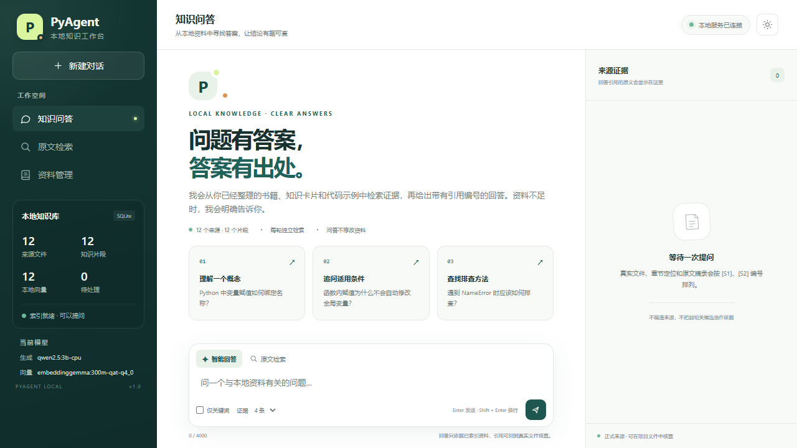
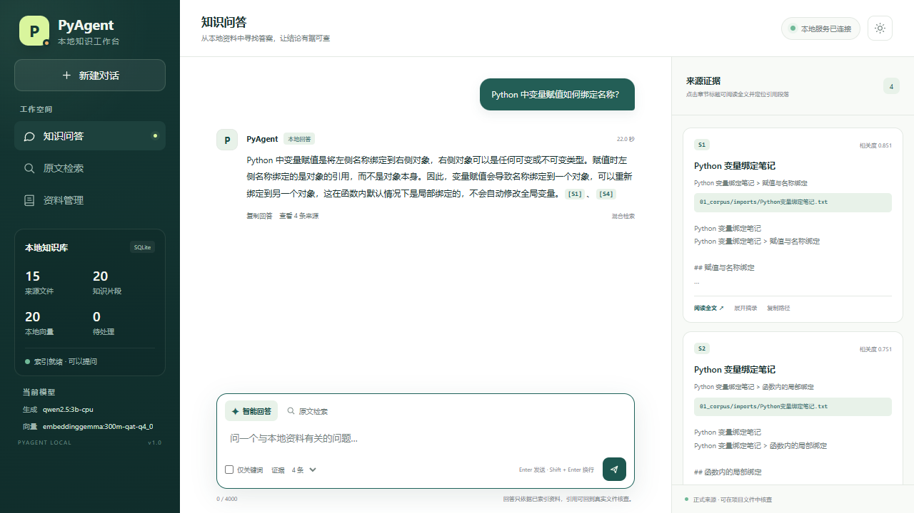
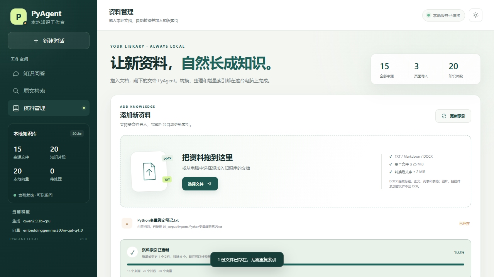
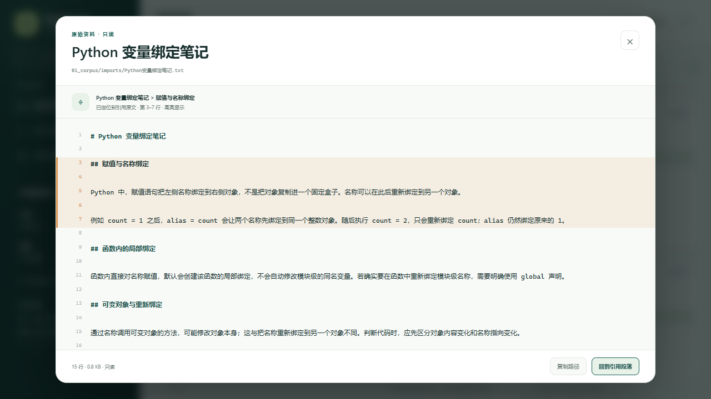
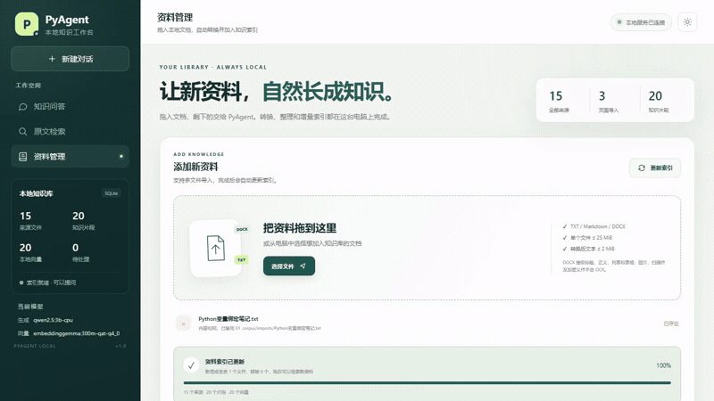

# PyAgent

**让本地资料问答有答案，也有出处。**

PyAgent 是一个以 Python 标准库为主的本地知识工作台，也保留了离线 Python 项目诊断与定点修复能力。本仓库同时提供完整应用源码、自动化测试、演示视频和验证文档；私人语料、模型文件、SQLite 索引、真实 `.env` 与运行数据不随仓库发布。

## 观看演示

- [完整演示视频（MP4，中文配音与字幕）](assets/pyagent-demo.mp4)
- [字幕文件（SRT）](assets/pyagent-demo.srt)
- [架构与模型分工](docs/ARCHITECTURE.md) · [验证结果与边界](docs/VALIDATION.md)



## 展示了什么

- **受控资料导入**：选择或拖入 TXT、Markdown、DOCX；DOCX 提取文字后转换为 Markdown。
- **自动增量索引**：按文件哈希复用未变化内容，为新增内容建立 SQLite 检索记录和本地向量。
- **有引用的本地问答**：混合关键词与向量检索，由本地 Qwen 整理回答，并展示 `[S#]` 来源。
- **全文核查**：从引用打开只读全文，定位对应章节或记录并高亮。
- **证据不足拒答**：弱相关候选不会冒充正式依据；拒答路径不调用生成模型。
- **资料管理**：搜索、类型筛选、分页、重复文件复用，以及导入资料的备份式移除。
- **桌面与移动布局**：明暗主题、手机侧栏，无外部前端运行时依赖。





## 本地运行

只需要 Python 与标准库即可查看代码和运行离线诊断；完整的本地知识问答还需要 Ollama 及相应模型。自动化测试另外使用 `pytest`。

```powershell
git clone https://github.com/b1789544020-sys/PyAgent.git
Set-Location PyAgent
Copy-Item .env.example .env
# 按 03_agent/SETUP.md 准备模型，并在 01_corpus/ 放入自己的资料
python 03_agent/web_ui.py
```

浏览器访问 `http://127.0.0.1:8765/`。Windows 用户也可使用 `启动PyAgent.bat`；模型路径、CPU 服务与数据目录的详细配置见 [安装与配置指南](03_agent/SETUP.md)。不要提交自己的 `.env` 或私人语料。

主要目录：`03_agent/`（知识工作台与 Agent）、`03_engine/`（离线诊断修复）、`02_assets/`（公开规则与微型测试）、`04_golden_tests/`（诊断样例）、`assets/`（公开媒体）、`docs/`（架构与验证）。

## 技术分工

| 组件 | 职责 |
|---|---|
| Qwen2.5 3B（通过 Ollama 运行） | 根据检索证据生成自然语言回答，不负责保存向量索引 |
| EmbeddingGemma 300M（通过 Ollama 运行） | 为检索内容生成 768 维向量 |
| Python + SQLite | 文档切块、增量索引、BM25/中文词片与向量混合检索、引用校验、全文定位及工作流 |
| 原生 HTML/CSS/JavaScript | 本地浏览器工作台，不需要 Node.js、前端构建或 CDN |

未使用 LangChain。导入和索引是推理前的资料准备，**不是训练模型**。



## 验证摘要

在完整项目中，2026-11-09 的自动化回归为 **144 项测试通过**。真实 Edge 流程覆盖了资料导入、拖放、增量索引、引用问答、全文高亮、拒答、备份移除、主题和移动布局；公开演示另行使用独立数据库与自写资料录制。

详见 [验证结果与边界](docs/VALIDATION.md)。测试通过和单个演示成功不代表任意模型回答都正确。

## 隐私与版权

- 视频中的资料是为演示专门编写的虚构场景与 Python 学习笔记，不包含原项目私人书籍、笔记或知识卡片。
- 录屏使用独立服务、数据库和干净浏览器配置，正式服务与正式语料不参与录制。
- 公开截图和视频不包含本机用户名、真实绝对路径、密钥、浏览器通知或私人文档内容。
- 未使用第三方电影、音乐、书籍截图或品牌素材。配音由后期合成，原始浏览器录屏无音轨。

## 范围与限制

- 本仓库包含应用源码和测试，但私人语料、模型与索引需要在本机单独准备；浏览器页面不能脱离本地 Python 与模型服务独立完成完整问答。
- 不提供公开在线互动版；GitHub Pages 或单个 HTML 文件无法独立复现 SQLite、索引和本地模型能力。
- 不直接支持 PDF、旧版 DOC、图片或扫描件 OCR；DOCX 仅提取可读取的文字、标题、列表和表格。
- 本地 3B 模型可能产生不合格引用，此时程序会回退为原文检索；生成答案仍需核查来源。
- 每轮问题独立检索，不宣称具有模型长期记忆。localhost 配置也不等于完成操作系统级断网验收。

## 本地预览媒体

GIF 预览：



完整 MP4、SRT 与 GIF 预览均已收入本仓库，可直接打开或下载。
